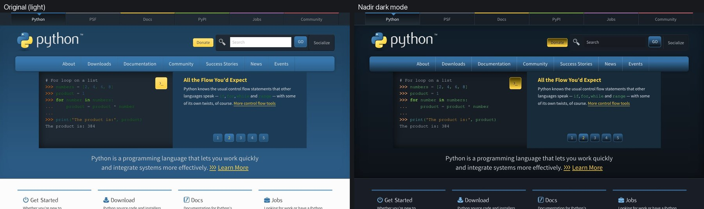
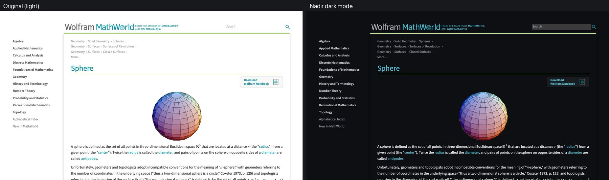
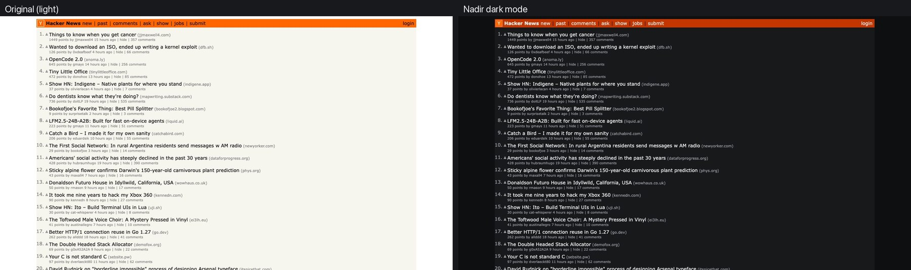
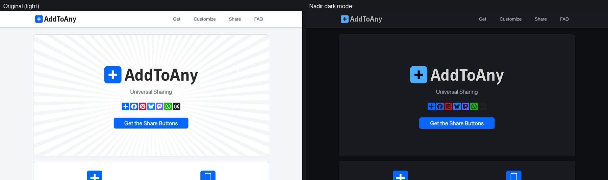
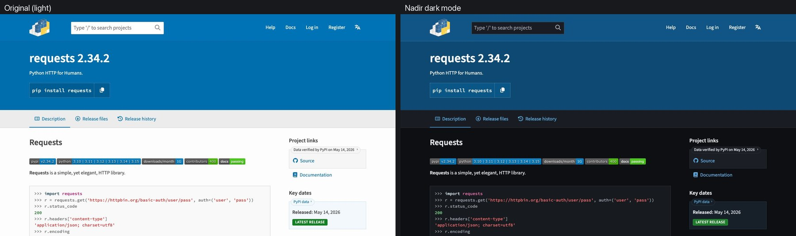
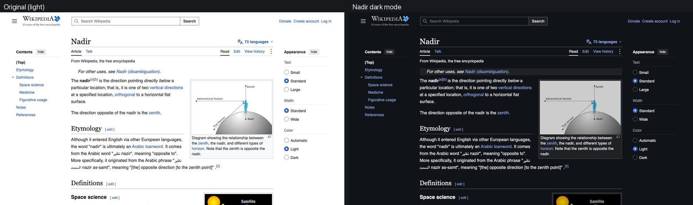

# Nadir

**Dark mode for every website, designed on your device by a small AI model.**

Nadir is a browser extension for Chrome, Edge, Brave, Arc and other Chromium browsers. When a site has no
dark mode, a 16M-parameter model reads the page's colours and images and designs a dark theme for that specific
site, the way the site's own designers would: brand colours stay recognizable, surfaces keep their hierarchy,
text stays readable, and logos, icons and formulas stay visible. Photos and videos are never recoloured.

Everything runs locally in the browser (onnxruntime-web, WASM). There are no accounts, no servers and no analytics.

## Demos

Left: the page as published. Right: the same page with Nadir. These are first visits in a fresh profile, rendered by [`training/ext_render.py`](https://huggingface.co/ProCreations/nadir/blob/main/training/ext_render.py) from the Hugging Face repository.

**GeoGebra.** The purple brand color and the illustration keep their colors; surfaces and text go dark.

**python.org.** The brand's blue and yellow stay, and the code sample keeps its syntax colors.

**Wolfram MathWorld.** Formula images are recolored so they read on the dark page; the rendered sphere keeps its colors.

**Hacker News.** The orange header stays; the beige page becomes a warm dark grey.

**AddToAny.** The light sunburst texture behind the hero is removed, the dark wordmark turns light, and the share buttons keep their brand colors.

**PyPI.** Badges, code blocks and the blue header keep their colors and hierarchy.

**Wikipedia** has its own dark theme, so Nadir switches that on instead of designing one.

## What it does

1. **Already dark? Left alone.**
2. **Has its own dark mode? Nadir turns it on.** It switches on the site's own `prefers-color-scheme` rules or
   dark class/attribute toggles.
3. **No dark mode? The model designs one.**
   - A palette head redesigns every colour in its role: background, text, border, shadow, gradient and SVG
     paint.
   - An element head decides how every image, CSS background, sprite and icon is shown:
     - *keep*: photos, artwork, colourful logos.
     - *invert*: dark glyphs, formulas, line art, with hues preserved.
     - *adapt*: dark text in a logo becomes light while brand colours stay and white boxes go.
     - *remove*: light textures behind content.
   - Deterministic guards then keep every text colour readable on every surface it sits on.

**Speed and size.** The 8-bit model is 21 MB and the element head 5 MB. On a new site the model pass itself takes about
30 ms (Apple M4 Max, 4 WASM threads). With page analysis and image measurement, the dark theme is in place 0.2–2 s
after the page loads; until then a dark curtain avoids a white flash. Revisits reuse the palette Nadir cached for
that site.

The model, its training data and its evaluation are on Hugging Face:
**[ProCreations/nadir](https://huggingface.co/ProCreations/nadir)**.

## Install

1. Download `nadir-extension.zip` from the [latest release](../../releases/latest) and unzip it. Or clone this
   repository and use the `extension/` folder.
2. Open `chrome://extensions` (`edge://extensions`, `brave://extensions`, …) and turn on **Developer mode**.
3. Click **Load unpacked** and choose the unzipped folder (the one containing `manifest.json`).

The toolbar badge shows what Nadir did on each site:
- `AI`: the model designed the dark mode.
- `ON`: the site's own dark mode is on.
- `OFF`: Nadir is turned off there.
- No badge: the site was already dark.

The popup can turn Nadir off for a site or everywhere.

Nadir works alongside content blockers such as uBlock Origin Lite. Removed ads simply aren't part of the
palette; ads that remain are treated as images and never recoloured.

## Privacy and permissions

- The page is analysed and the model runs inside your browser. Nothing about the pages you visit is sent anywhere.
- Nadir caches the palette it designed for each site in the extension's local storage, so revisits are instant.
- `<all_urls>` host access lets Nadir:
  - restyle any site;
  - read cross-origin stylesheets and images that the page itself already loads, from the extension's own
    context, to measure them.
- `offscreen` hosts the model (onnxruntime-web) in a hidden extension page shared by all tabs.
- `scripting` registers a small main-world script the engine needs to see stylesheets the page builds in
  JavaScript.
- `tabs` lets Nadir take a screenshot of the visible tab, only to measure inline SVG logos while the page is
  still light; the screenshot never leaves the extension.
- `declarativeNetRequestWithHostAccess` gives the extension's own requests for a page's images and stylesheets the
  page's origin as the Referer, as the page's own requests had (some sites refuse image requests without one). These
  rules apply only to requests the extension itself makes, never to the page's requests.
- `storage` and `unlimitedStorage` hold the per-site cache and your settings.

## How it works

| Piece | File |
|---|---|
| Page analysis: every colour in its role, structure relations, and every visible image, background, sprite and pseudo-element icon | `extension/lib/extract.js` |
| Model inputs and outputs, and the design guards (contrast on every surface, hue guard, invisible-stays-invisible) | `extension/lib/nadir-infer.js` |
| Palette lookup for colours the model did not see, and image adaptation | `extension/lib/nadir-map.js` |
| Patched [Dark Reader](https://github.com/darkreader/darkreader) 4.9.133 dynamic engine (MIT): stylesheets, inline styles, shadow DOM and dynamic content, asking Nadir for every colour and image | `extension/lib/darkreader-nadir.js` |
| Model runner (page graph + element graph) | `extension/offscreen.js` |
| Content script and per-site logic | `extension/content.js` |
| Models: int8 palette model and the element head | `extension/model/` |

## Updating the model

The release ships the 8-bit page model (`extension/model/nadir.onnx`, the same file as `nadir-int8.onnx` on Hugging Face), the
element graph (`nadir-elem.onnx`) and its calibration temperature (`nadir-meta.json`).
- **4-bit model:** to use it, download `nadir-int4.onnx` from Hugging Face and save it as
  `extension/model/nadir.onnx`.
- **Full-precision model:** `nadir-fp32.onnx` is also on Hugging Face.

## License

- Nadir's code and models: Apache-2.0.
- The bundled Dark Reader engine: MIT (`extension/lib/DARKREADER-LICENSE`).
- onnxruntime-web: MIT.
